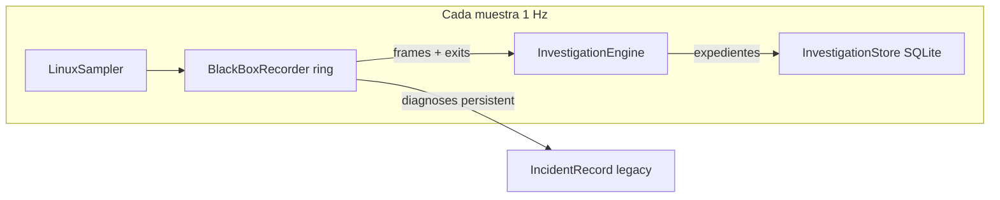

# Fase 3–4 — Motor de investigación

## Arquitectura



- **Evento / anomalía / incidente**: clasificación en `InvestigationLevel`. El impacto (`ImpactAssessment`) es independiente de la atribución (`AttributionEvidence`).
- **Regla** `intermittent_cpu_burst`: ventana temporal 20 s, ≥4 muestras con CPU de un núcleo ≥70 %, huecos permitidos. Parámetros vía `HEIMDALL_BURST_*` y `InvestigationConfig`.
- **Confianza de atribución**: `high` | `medium` | `insufficient` con `confidence_rationale` textual (sin probabilidades inventadas).

## IPC (contratos para la UI)

| Método | Params | Respuesta |
|--------|--------|-----------|
| `list_investigations` | `limit` | `InvestigationSummary[]` |
| `get_investigation` | `investigationId` | `InvestigationDossier \| null` |
| `export_investigation` | `investigationId` | `{ json: string }` |
| `explain_investigation` | `investigationId`, `question?`, `model?` | `AssistantReply` (HTTP Ollama fuera del candalo) |

Incidentes de diagnóstico (`list_incidents`) siguen igual; las investigaciones usan tabla `investigations` en `blackbox.db`.

## Benchmarks (≥5 min por escenario)

Ejecutar con daemon release y medir `/proc` (mismo método que fases 1–2):

```bash
cargo build -p heimdall-daemon --release --example bench_embedded
./target/.../bench_embedded spaced   # 20 muestras, ~20 s (acortar repetición para 5 min)
```

Variables: daemon reposo, UI conectada, carga intermitente (`scripts/investigation-burst-demo.py`), dos investigaciones simultáneas.

## Pruebas A–K

Cobertura en `cargo test -p heimdall-investigation` (sintéticas) + demo en vivo con `scripts/investigation-burst-demo.py` contra daemon.